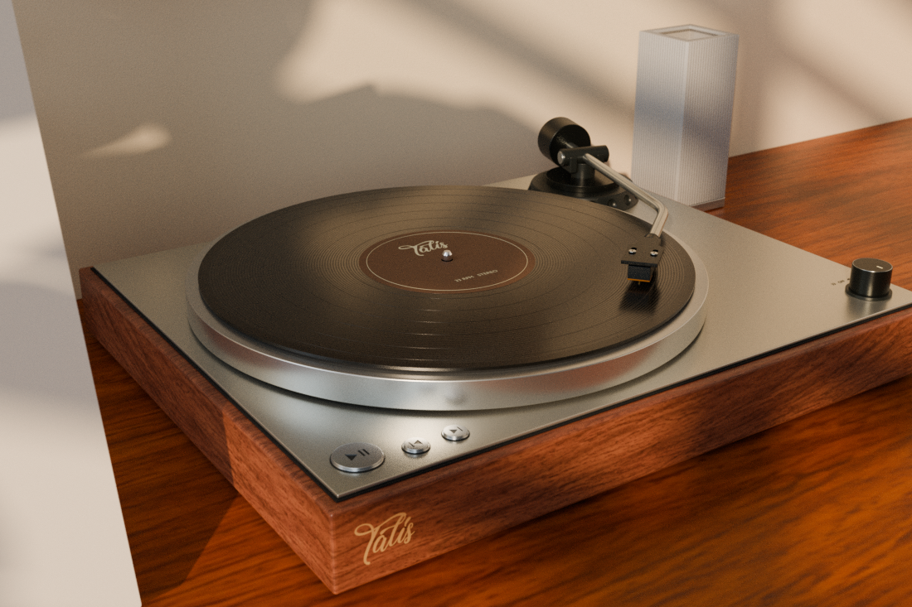
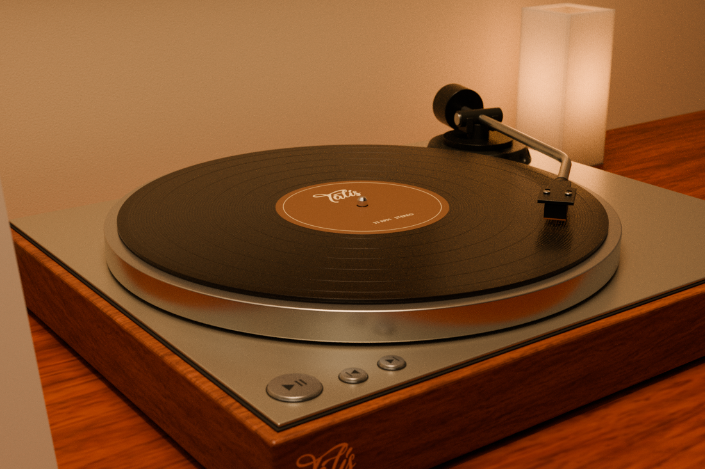
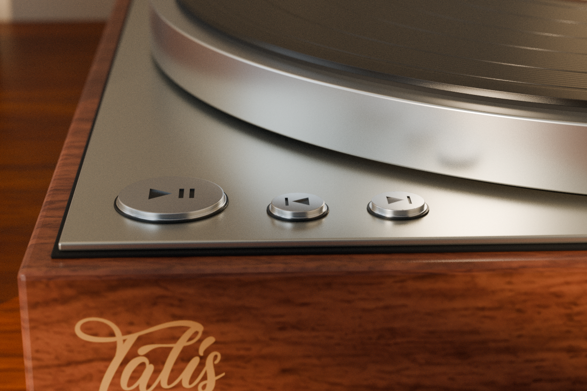
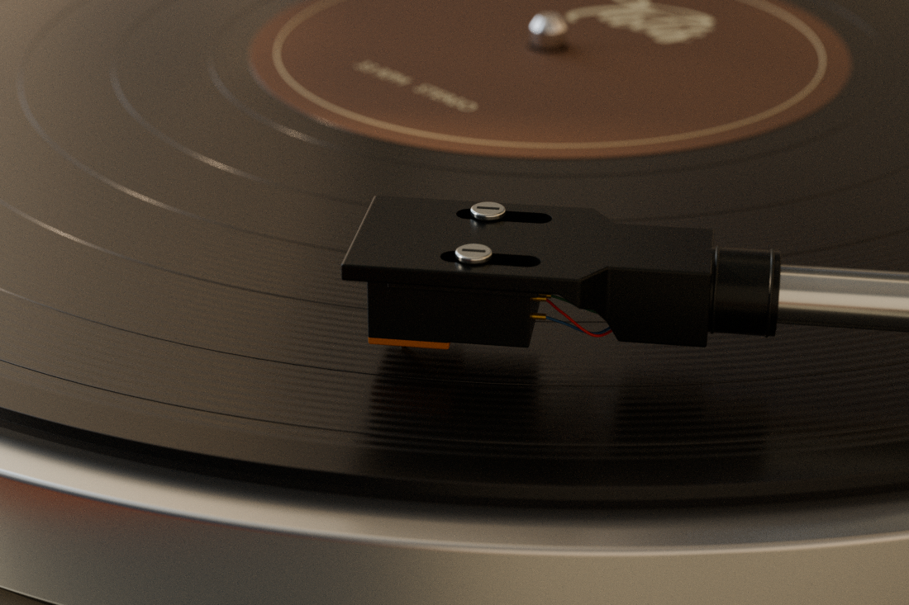
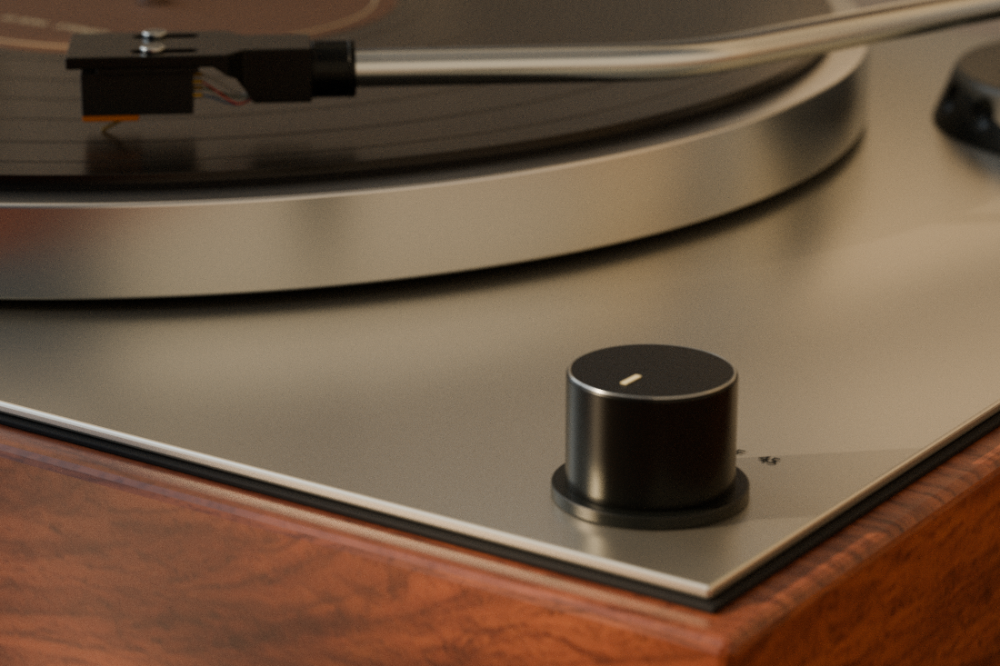
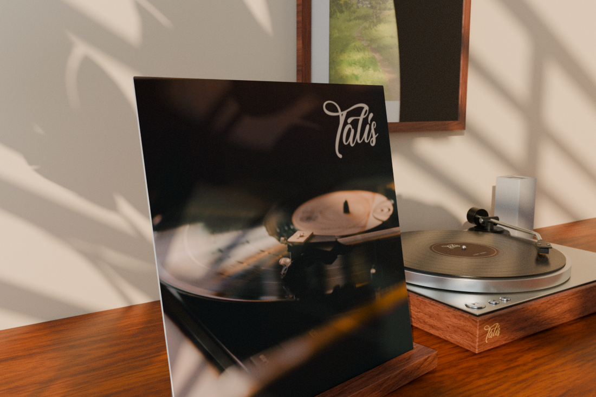

# Talis

An interactive, music-aware, animated turntable that brings the classic vinyl experience to your Linux desktop.

Watch records spin and the tonearm glide in real time as your music plays—and control your playback directly from the turntable.

| Day scene (4K) | Night scene (4K) |
| --- | --- |
|  |  |

| Live playback controls | Moving tonearm and vinyl |
| --- | --- |
|  |  |

| Player volume control | Album sleeve with live song coverart |
| --- | --- |
|  |  |

> **Live cover art:** During playback, the sleeve and vinyl shows cover art from your music player when available.

## Install

Choose a prebuilt package for your distribution (x86-64). No Rust or build tools
needed. Run commands from your download folder and replace the example filename
with the one you downloaded.

### Ubuntu / Debian / Linux Mint

```sh
sudo apt install ./talis_VERSION_amd64.deb
```

### Arch / CachyOS

```sh
sudo pacman -U ./talis-bin-VERSION-x86_64.pkg.tar.zst
```

### Fedora

```sh
sudo dnf install ./talis-VERSION.x86_64.rpm
```

Open **Talis** from your application menu after installation.

### Other distributions — portable archive

Extract the portable `.tar.gz` into a permanent folder. Open a terminal there:

```sh
./talis
```

On GNOME Wayland, run `bash setup-gnome.sh` once before `./talis`.
Keep the extracted folder in place. [Portable setup and dependencies](packaging/PORTABLE.md).

## Usage

- Play music in your usual player. Talis follows it automatically; select a
  specific app under **General → Music source** if needed.

- Use the turntable to control playback and volume. Controls and cover art
  depend on what your player provides.

- Adjust appearance and performance in **Settings**. Enable **General → Run on
  startup** to start at sign-in, where available.

## Desktop notes

| Desktop or session | Integration |
| --- | --- |
| GNOME (Wayland) | Follow the setup prompt; log out/in if asked. The enabled companion handles startup. [Setup guide](integrations/gnome/README.md). |
| KDE Plasma, Hyprland, Sway (Wayland) | Use the RPM, Arch package or portable archive. |
| Cinnamon, KDE Plasma (X11) | Native X11 integration. |
| MATE (X11) | Enable **Advanced → MATE compatibility**. Desktop icons are hidden while active. |
| Xfce (X11) | Desktop icons are currently covered while Talis runs. |

## License

Application code: [GPL-3.0-only](LICENSE). Scene and third-party asset terms:
[licensing and credits](LICENSING.md).
